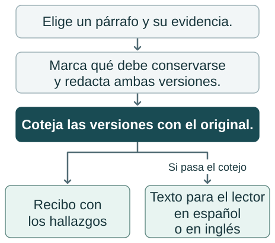

# Scientific Writing Guardrail

¿Tu paper sigue diciendo lo mismo después de editarlo o traducirlo? Esta herramienta te ayuda a revisar un pasaje científico en **español e inglés**. Tú eliges qué afirmaciones, cifras y condiciones deben conservarse. El programa compara ambas versiones con el original y señala dónde volver a mirar.

## Un ejemplo con 12 registros y 3 parcelas

Un inventario ficticio cuenta **12 registros de observación en 3 parcelas**. Varias observaciones pueden corresponder al mismo organismo. Así responde el programa cuando comprueba las cifras de este ejemplo.

| Si la versión dice… | ¿Qué ocurre? |
| --- | --- |
| **12 registros en 3 parcelas** | Pasa el cotejo. Las cantidades conservan su significado. |
| **13 registros en 3 parcelas** | Salta una alerta. Falta el **12** que se marcó en el original. |
| **3 registros en 12 parcelas** | También pasa. Las dos cifras siguen ahí, pero ahora cuentan cosas distintas. El revisor debe detectar el intercambio. |

[Probar los tres casos con el inventario](examples/biodiversity/README.md)

## Qué haces tú y qué recibes



A quien revise el texto puedes preguntarle **«¿Qué se contó y dónde?»** Una respuesta como «12 organismos» revela otra confusión, incluso si el programa aceptó el pasaje.

## Pruébalo en tu equipo

**[Descarga el ZIP de la versión 0.2.0](https://github.com/sjaramillov/scientific-writing-guardrail/releases/download/v0.2.0/scientific-writing-guardrail-0.2.0.zip)**, descomprímelo y abre `LEEME.html` con doble clic. Podrás leer la guía visual en tu navegador sin conexión. Para ejecutar el ejemplo necesitas Python.

Desde la carpeta del repositorio, con **Python 3.9 o posterior**, este comando muestra el borrador en español. Funciona sin conexión y usa únicamente la biblioteca estándar de Python.

```sh
python3 guardrail.py render examples/biodiversity/source.txt examples/biodiversity/packet.json --language es
```

Para ver qué comprobó el programa, ejecuta el cotejo sobre los mismos archivos.

```sh
python3 guardrail.py check examples/biodiversity/source.txt examples/biodiversity/packet.json
```

Si aparece `ready_for_human_review`, el pasaje está listo para que alguien revise la evidencia y el significado. En una evaluación con tres artículos nuevos, las 12 alteraciones en español y sus 12 equivalentes en inglés pasaron sin alerta. [Cómo se evaluó y qué errores quedaron](docs/evidence-and-evaluation.md#qué-detectó-el-programa)

## Para trabajar con tu paper

- **Tengo un manuscrito.** Empieza por un párrafo, su fuente y una pregunta que el lector debería poder contestar. [Guía para editar un pasaje](docs/editing-protocol.md)
- **Quiero usar la herramienta.** Prepara los archivos, interpreta las alertas y exporta una copia para revisión. [Guía de uso](docs/uso.md)
- **Mi resultado depende de una hipótesis.** Declara a qué objetos se aplica y comprueba qué ocurre si se pierde esa condición. [Propiedades y alcance de una afirmación](docs/claim-properties.md)

La versión **0.2.0** admite los formatos de trabajo 1 a 6, incluidos los paquetes creados con la versión 0.1.0. Para citar esta edición, usa **Sebastian Jaramillo Valderrama (2026), Scientific Writing Guardrail, versión 0.2.0**. [Ficha de la versión](https://github.com/sjaramillov/scientific-writing-guardrail/releases/tag/v0.2.0)

[Antecedentes](docs/related-work.md) · [Cómo citar el proyecto](CITATION.cff) · [Licencia Apache 2.0](LICENSE)
